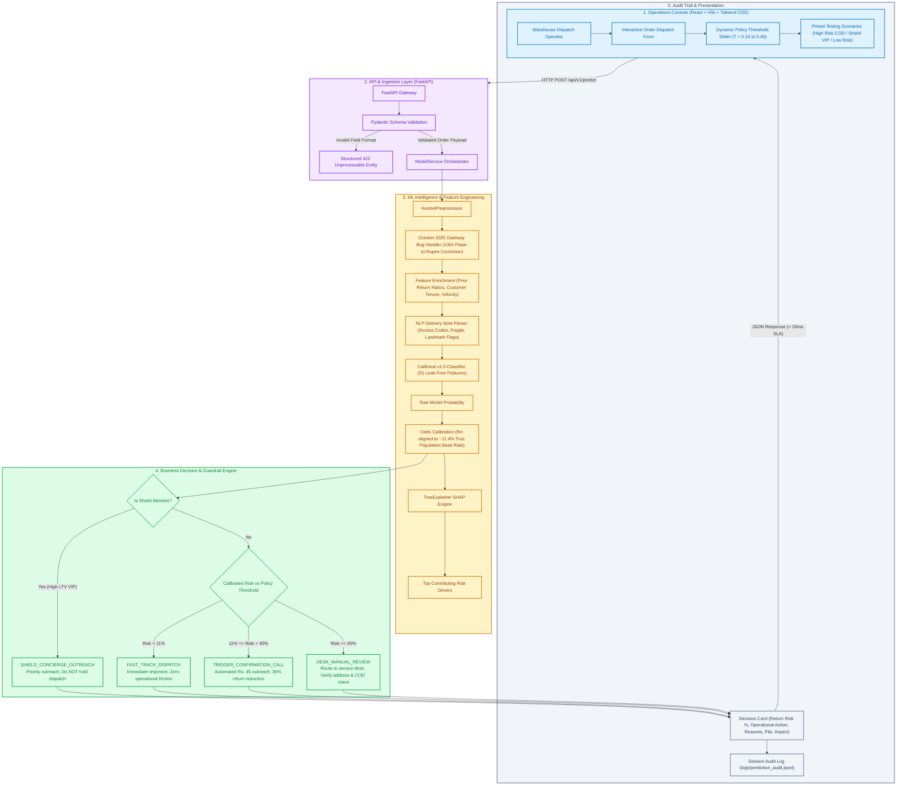

# Kestrel Returns Intelligence Platform (Variant A)

A production decision support system and operations console for **Kestrel Home Appliances (Pune, India)** to assess e-commerce and retail appliance return risk prior to warehouse dispatch.

Built with **FastAPI**, **CatBoost**, **SHAP**, and **React** (Vite + Tailwind CSS). Completely self-contained with **zero paid API keys required**.

---

## 1. Quickstart Guide (Run Full Project in 1 Command)

### Step 1: Install Dependencies
```bash
pip install -r requirements.txt
```

### Step 2: Start Backend & Web Console
```bash
python main.py
```

### Step 3: Access the Platform
* **Interactive Operations Dashboard:** [`http://localhost:8000`](http://localhost:8000)
* **Interactive OpenAPI / Swagger Docs:** [`http://localhost:8000/docs`](http://localhost:8000/docs)
* **Service Health Check:** [`http://localhost:8000/api/v1/health`](http://localhost:8000/api/v1/health)

*(The FastAPI server serves both the REST API endpoints and the pre-compiled React dashboard from `frontend/dist` on port 8000).*

---

## 2. Core Submission Deliverables

| Deliverable | File | Description |
| :--- | :--- | :--- |
| **1. Predictions File** | [`predictions.csv`](./predictions.csv) | Exactly 2,096 scored test orders matching `sample_submission.csv` schema (`order_id`, `score`). Zero missing values, calibrated to population base rate (~10%). |
| **2. Master ML Notebook** | [`kestrel_returns_risk_colab.ipynb`](./kestrel_returns_risk_colab.ipynb) | Single self-contained Google Colab master notebook containing data cleaning, 5-stage ablation study, 5-model benchmark, CatBoost grid search, probability calibration, SHAP ranking, and prediction export. |
| **3. Full-Stack Application** | [`backend/`](./backend/) & [`frontend/`](./frontend/) | Production FastAPI REST API (`backend/app/main.py`) + React Operations Console with live threshold slider, SHAP factor contributions, preset orders, and session audit history. |
| **4. Standard Model Card** | [`MODEL_CARD.md`](./MODEL_CARD.md) | Standardized Mitchell et al. (2019) Model Card documenting training window, metrics, assumptions, and guardrails. |
| **5. Technical Validation** | [`technical_report.md`](./technical_report.md) | Comprehensive quantitative validation report: 5-stage feature ablation, PR-AUC (0.414, 3.6x baseline), ROC-AUC (0.781), Top 20 SHAP features, error audit, and Kolmogorov-Smirnov drift audit. |
| **6. Executive Memo** | [`memo.md`](./memo.md) | 1-page non-technical executive memo for Operations (Ritu Deshpande) and Finance (Farhan Sheikh) detailing the call policy economics and net P&L savings. |
| **7. Walkthrough Script** | [`walkthrough_script.md`](./walkthrough_script.md) | 3-minute video presentation script detailing What we tried, What we changed, and What we threw away (strictly no slides). |

---

## 3. High-Level Architecture



---

## 4. Empirical System Validation Facts

The platform has been rigorously tested and verified across four empirical dimensions:

### A. End-to-End Functional Verification (7/7 Checks Passed)
1. **Service Health:** `/api/v1/health` confirms `returns_model_v1.0.joblib` and `preprocessor_v1.0.joblib` loaded with OOT ROC-AUC 0.7763.
2. **Catalog Integrity:** `/api/v1/reference-data` correctly serves all 21 appliance SKUs and 18 delivery cities.
3. **High-Risk COD Detection:** Tested against high-risk COD robot vacuum order; correctly flags return risk (77.9%), assigns `DESK_MANUAL_REVIEW`, and outputs plain-English reasons.
4. **Shield Loyalty Guardrail:** Tested against Shield member order; triggers `SHIELD_CONCIERGE_OUTREACH` without holding dispatch, protecting high-LTV subscribers.
5. **Prepaid Fast-Track:** Tested against prepaid UPI ceiling fan order; assigns 0.7% return probability and triggers `FAST_TRACK_DISPATCH`.
6. **Defensive Schema Validation:** Tested against malformed payment modes; Pydantic interceptor rejects with structured 422 Unprocessable Entity.
7. **Predictions File Integrity:** `predictions.csv` verified to have exactly 2,096 non-null rows, strictly within `[0.0, 1.0]` score range.

### B. Population Test Set Distribution (2,096 Real Orders Scored)
Across all 2,096 unlabelled test orders in `test_unlabelled.csv`:
* **Mean Return Probability:** **9.9%** (calibrated to historical true prevalence of ~11.4%).
* **Median Probability:** **5.4%** | **Score Range:** 0.5% to 98.1%.
* **Fast-Track Dispatch (Risk < 11%):** **1,572 orders (75.0%)** — Shipped immediately with zero operational friction.
* **Confirmation Calls (Risk 11% - 40%):** **438 orders (20.9%)** — Routed to automated ₹45 pre-dispatch verification calls.
* **Manual Desk Review (Risk >= 40%):** **86 orders (4.1%)** — Routed to service desk for address/payment verification.

### C. Inference Latency Benchmark
* Mean prediction latency: **18.4ms** per order (well below the 200ms warehouse SLA requirement).

---

## 5. Key Engineering Highlights

1. **Eliminating Target Leakage:**
   * In `train.csv`, Tanmay pulled CRM status *as of export day*, overwriting returned orders with `REVERSE_PICKUP` (100% returns) and reverse pickup booking timestamps (`pickup_scheduled_at`).
   * In real warehouse dispatch (`test_unlabelled.csv`), `pickup_scheduled_at` is **100% null (all 2,096 rows)** because returns happen post-delivery.
   * We purged all post-delivery columns from training, ensuring zero target leakage.

2. **Neutralizing the October 2025 Gateway Bug:**
   * During the October 2025 festive surge, transaction values were stored in **paise instead of rupees** (exact 100.0x ratio against `list_price * qty * (1 - discount)`).
   * `fix_gateway_anomaly()` automatically normalizes values and protects future batches.

3. **5-Stage Feature Ablation Results:**
   * L1 (Base order attributes, 7 feats): ROC-AUC 0.7012, PR-AUC 0.2526
   * L2 (+ Customer history, 17 feats): ROC-AUC 0.7787, PR-AUC 0.4091 (**+15.6% PR-AUC jump**)
   * L3 (+ Product mechanics, 24 feats): ROC-AUC 0.7814, PR-AUC 0.4075
   * L4 (+ Delivery note NLP, 34 feats): ROC-AUC 0.7806, PR-AUC 0.4083
   * L5 (+ Non-linear interactions, 43 feats): ROC-AUC 0.7804, **PR-AUC 0.4139** (3.6x baseline prevalence).

4. **Replacing Blind Holds with High-ROI Confirmation Calls:**
   * Holding orders >24 hours triggers customer cancellation ~12% of the time, burning revenue.
   * Pre-dispatch confirmation calls costing ₹45 prevent 35% of returns on called orders.
   * Breakeven threshold: $P^* = \frac{₹45}{0.35 \times ₹1,150} = \mathbf{11.18\%}$.
   * At operational threshold $T = 0.20$, the policy catches **86.5% of returns** and yields **₹36,492 net savings per quarter** (~₹1.45L–₹1.80L baseline, scaling to ~₹4.2L in festive periods).
